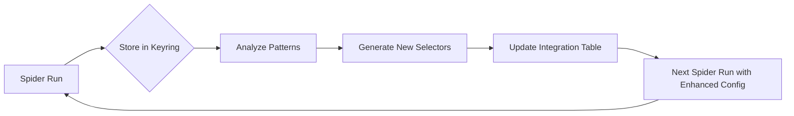

# Web Spider Design Technologies Reference Table

## Overview
This table provides a comprehensive overview of web technologies and their applicability for designing unique, custom web spiders. Each section covers key aspects that can be leveraged to make spiders unique by design.

---

## CSS for Spider Uniqueness

| CSS Aspect | Capabilities for Unique Spiders | Use Cases |
|------------|--------------------------------|-----------|
| **Selectors** | Attribute selectors, pseudo-classes, ID selectors, class hierarchies | Target specific elements without affecting others |
| **Dynamic Selectors** | XPath compatibility, complex attribute matching | Adapt to changing page structures |
| **Shadow DOM** | Styling isolated components | Scrape web components with encapsulated DOM |
| **CSS Variables** | Theming and dynamic styling | Adapt to different site designs |
| **::before/::after** | Content injection for identification | Add markers without modifying HTML |
| **:nth-child/ :nth-of-type** | Precise element targeting | Select specific items in lists/grids |
| **Attribute Contains** `[class*="item"]` | Flexible matching | Handle dynamic class names |

**Example for unique spider:**
```css
/* Target specific product cards */
div.product-card:nth-of-type(n+3):nth-of-type(-n+6) {
  /* Extraction rules */
}

/* Adaptive selector with fallback */
[data-testid="product"]::attr(data-id),
[class*="product-item"]::attr(id)
{
  fallback: unique-class-name;
}
```

---

## HTML for Spider Uniqueness

| HTML Aspect | Capabilities for Unique Spiders | Use Cases |
|------------|--------------------------------|-----------|
| **Semantic Elements** | `<header>`, `<main>`, `<article>`, `<section>` | Context-aware extraction |
| **Data Attributes** | `data-*` attributes for metadata | Spider-specific identifiers |
| **ARIA Attributes** | `role`, `aria-label`, `aria-expanded` | Accessibility-based targeting |
| **Microdata/Microformats** | Schema.org, hCard, hProduct | Structured data extraction |
| **ID Uniqueness** | Must be unique per page | Primary targeting mechanism |
| **Class Naming Conventions** | BEM, SMACSS, CSS Modules | Predictable structure handling |
| **Inline vs External** | SVG, CSS in JS, styled-components | Dynamic content handling |

**Example for unique spider:**
```html
<!-- Unique identifier attributes -->
<article class="product-card" 
       data-product-id="{{unique_id}}"
       data-category="{{category}}"
       itemscope itemtype="http://schema.org/Product">
  <h2 itemprop="name">{{title}}</h2>
  <span itemprop="price">{{price}}</span>
</article>

<!-- Dynamic data attributes -->
<div class="item" 
     data-unique="{{timestamp}}-{{random}}>
  <!-- Spider can track unique instances -->
</div>
```

---

## PHP for Server-Side Spider Design

| PHP Aspect | Capabilities for Unique Spiders | Use Cases |
|------------|--------------------------------|-----------|
| **Dynamic Content Generation** | PHP templates, variables, functions | Site-specific spider configurations |
| **Session Handling** | $_SESSION, cookies | Track spider sessions and state |
| **HTTP Headers** | Custom headers, user-agent rotation | Anti-detection techniques |
| **Output Buffering** | ob_start(), ob_get_contents() | Capture and modify rendered HTML |
| **cURL Integration** | HTTP requests, proxy support | Programmatic spider access |
| **DOM Manipulation** | DOMDocument, SimpleXML | Server-side parsing before spidering |
| **Authentication** | Login systems, API keys | Protected content access |

**Example for unique spider:**
```php
<?php
// Unique spider configuration per site
$spider_config = [
    'site' => 'example.com',
    'user_agent' => 'UniqueSpider/1.0 (' . $_SERVER['HTTP_HOST'] . ')',
    'delay' => rand(1, 3), // Random delay per instance
    'selectors' => [
        'product' => '.product-item',
        'price' => '[itemprop="price"]'
    ],
    'auth' => [
        'enabled' => false,
        'credentials' => null
    ]
];

// Generate unique spider instance ID
$spider_id = 'spider_' . uniqid(mt_rand(), true);

// Store session for this spider
session_start();
$_SESSION['spider_id'] = $spider_id;
$_SESSION['config'] = $spider_config;

// Custom user-agent rotation
function get_random_user_agent() {
    $agents = [
        'Mozilla/5.0 (Windows NT 10.0; Win64; x64)',
        'Mozilla/5.0 (Macintosh; Intel Mac OS X 10_15_7)',
        'Googlebot/2.1 (+http://www.google.com/bot.html)'
    ];
    return $agents[array_rand($agents)];
}
?>
```

---

## XML for Data Exchange and Structure

| XML Aspect | Capabilities for Unique Spiders | Use Cases |
|------------|--------------------------------|-----------|
| **Structured Data** | Custom schemas, DTDs, XML Schema | Define spider data formats |
| **Namespaces** | Custom namespaces for separation | Isolate spider-specific data |
| **XPath/XPointer** | Precise node navigation | Complex data extraction |
| **XSLT** | Transform XML to desired formats | Spider output transformation |
| **Custom Elements** | XML-based custom tags | Spider-specific metadata |
| **Atom/RSS Feeds** | Syndication formats | Alternative content sources |
| **WSDL/SOAP** | Web service definitions | API-based spidering |

**Example for unique spider:**
```xml
<?xml version="1.0" encoding="UTF-8"?>
<product xmlns="http://example.com/spider-schema"
         xmlns:xsi="http://www.w3.org/2001/XMLSchema-instance"
         xsi:schemaLocation="http://example.com/spider-schema product.xsd">
    <id>{{unique_id}}</id>
    <name>{{title}}</name>
    <price>{{price}}</price>
    <meta>
        <spider_version>1.0</spider_version>
        <extraction_timestamp>{{timestamp}}</extraction_timestamp>
        <source_url>{{url}}</source_url>
        <session_id>{{session_id}}</session_id>
    </meta>
</product>
```

**Custom XML Schema for spiders:**
```xml
<?xml version="1.0" encoding="UTF-8"?>
<xs:schema xmlns:xs="http://www.w3.org/2001/XMLSchema"
           targetNamespace="http://example.com/spider-schema"
           elementFormDefault="qualified">
    <xs:element name="product">
        <xs:complexType>
            <xs:sequence>
                <xs:element name="id" type="xs:string"/>
                <xs:element name="name" type="xs:string"/>
                <xs:element name="price" type="xs:decimal"/>
                <xs:element name="metadata" type="xs:string" minOccurs="0"/>
            </xs:sequence>
        </xs:complexType>
    </xs:element>
</xs:schema>
```

---

## Web Server Configurations for Spider Design

| Server Aspect | Capabilities for Unique Spiders | Use Cases |
|------------|--------------------------------|-----------|
| **Apache** | .htaccess, mod_rewrite, mod_proxy | Per-directory spider configurations |
| **Nginx** | location blocks, rewrite rules, upstream configs | High-performance spider routing |
| **IIS** | Web.config, handlers, modules | Windows-based spider infrastructure |
| **Reverse Proxy** | Caching, load balancing, request filtering | Distributed spider architectures |
| **VM/Container** | Docker, Vagrant, VM configurations | Isolated spider environments |
| **SSL/TLS** | Certificates, forced HTTPS, SNIP | Secure spider communications |
| **Rate Limiting** | ModSecurity, fail2ban, limit_req | Spider traffic management |

**Example Apache .htaccess for spider:**
```
# Unique spider configuration
SetEnv SPIDER_ID "unique-spider-123"
SetEnv SPIDER_DELAY "2"

# Rate limiting for spider protection
<IfModule mod_ratelimit.c>
    SetOutputFilter RATE_LIMIT
    Ratelimit out 500
</IfModule>

# Custom logging for spider tracking
CustomLog "/var/log/apache2/spider-access.log" combined

# Header modifications for spider identification
Header set X-Spider-Instance "%{SPIDER_ID}e"
Header set X-Spider-Delay "%{SPIDER_DELAY}e"

# Disable caching for spider feeds
ExpiresActive Off
Header set Cache-Control "no-cache, no-store, max-age=0, must-revalidate"
Header set Pragma "no-cache"
```

**Example Nginx location for spider:**
```nginx
location /spider/ {
    # Unique per-spider settings
    set $spider_id "unique-instance-456";
    set $spider_delay "1.5";
    
    # Rate limiting zone
    limit_req zone=spider_zone burst=10 nodelay;
    
    # Proxy configuration
    proxy_set_header X-Spider-Id $spider_id;
    proxy_set_header User-Agent "UniqueSpider/1.0";
    
    # Caching control
    add_header Cache-Control "no-cache, no-store";
    expires -1;
    
    # Backend selection based on spider type
    proxy_pass http://backend-{{spider_type}};
}

# Spider rate limiting zone definition
limit_req_zone $spider_id zone=spider_zone:10m rate=1r/s;
```

---

## Design Principles for Unique Spiders

| Principle | Implementation | Benefits |
|-----------|---------------|----------|
| **Modular Design** | Separate components for each site | Reusable spider parts, easier maintenance |
| **Configuration-Based** | External config files (YAML, JSON, PHP) | Site-specific without code changes |
| **Feature Toggles** | Feature flags, environment variables | A/B testing different extraction approaches |
| **Fallback Strategies** | Multiple selector attempts, graceful degradation | Handle site structure changes |
| **Fingerprinting** | User-agent, header combinations, IP rotation | Avoid detection and blocking |
| **Adaptive Learning** | Machine learning for selector improvement | Self-improving spiders over time |
| **Distributed Architecture** | Multiple spider instances, load balancing | Scale spider operations |

---

## Integration Table: Technology Combinations

| Combination | Use Case | Example |
------------|----------|---------||
**CSS + HTML** | Front-end scraping | BeautifulSoup + CSS selectors |
**PHP + XML** | Server-side processing | CMS-driven content extraction |
**XML + Web Server** | Data feeds and APIs | RSS aggregation, XML endpoints |
**CSS + PHP** | Dynamic content extraction | Rendered page scraping |
**All 5 Technologies** | Enterprise spider systems | Complete spider infrastructure |
**HTML + Web Server** | Basic web scraping | Simple content extraction |
**PHP + CSS** | PHP-rendered pages | Headless browser integration |
**CSS + XML** | Selective data extraction from XML feeds | XPath-to-CSS conversion, attribute matching |
**PHP + JSON** | API data processing | REST API integration, JSON parsing and transformation |
**XML + JSON** | Data format conversion | XML-to-JSON transformation, schema mapping |
**HTML + PHP** | Server-side rendering | PHP-generated HTML, template processing |
**XPath + CSS** | Dual selector strategies | Fallback extraction with both syntaxes ||

---

## Best Practices for Unique Spider Design

1. **Respect robots.txt** - Always check before spidering
2. **Implement rate limiting** - Prevent server overload
3. **Use proper identification** - Set unique User-Agent headers
4. **Handle errors gracefully** - Retry logic, fallback selectors
5. **Store extracted data consistently** - XML/JSON schemas
6. **Monitor and maintain** - Regular spider health checks
7. **Legal compliance** - Terms of service, data usage policies
8. **Document spider configurations** - Track what each spider extracts

## Loopback Mechanisms: Data Recursion for Spider Enhancement

| Loopback Type | Data Source | Generated Artifacts | Feed Into Table Of Generation |
|--------------|-----------|-------------------|------------------------------|
| **Keyring-Encrypted Caching** | Crawled data stored in system keyring | Encrypted data blobs, session tokens | New spider class templates |
| **Selector Recursion** | Extracted selectors from previous runs | Improved selector taxonomies, fallback chains | CSS + XPath + CSS row |
| **Content Pattern Mining** | Extracted content structures | New data models, schema definitions | XML + JSON row |
| **Path Auto-Generation** | URL patterns and navigation graphs | Dynamic path generators, sitemap creators | HTML + Web Server row |
| **Class Factory** | Metadata from crawled pages | New spider class definitions, plugin templates | PHP + CSS row |
| **Map Reconstruction** | Site architecture from crawls | Updated site maps, dependency graphs | All 5 Technologies row |

### Keyring Integration Pattern

```python
# Loopback: Store crawled data in keyring, generate new spider components
import keyring
import json

def store_crawled_data(session_name, data):
    """Store crawled data encrypted in system keyring"""
    keyring.set_password(
        'web-spider',
        session_name,
        json.dumps(data)
    )

def retrieve_crawled_data(session_name):
    """Retrieve and decrypt crawled data from keyring"""
    try:
        raw = keyring.get_password('web-spider', session_name)
        return json.loads(raw) if raw else None
    except Exception:
        return None

def generate_spider_variant(base_config, extracted_patterns):
    """Generate new spider class from extracted patterns"""
    variant = base_config.copy()
    variant['selector_updates'] = extracted_patterns.get('selectors', {})
    variant['schema_updates'] = extracted_patterns.get('schemas', {})
    variant['path_updates'] = extracted_patterns.get('paths', {})
    return variant
```

### How Loopback Feeds the Generation Table

1. **Data Collection** - Each spider run stores extracted metadata in keyring
2. **Pattern Analysis** - System analyzes successful extraction patterns
3. **Artifact Generation** - New classes/maps/paths are auto-generated
4. **Table Update** - The integration table gets new rows for combination types that worked
5. **Version Loop** - Next spider run uses enhanced configurations automatically

### Example Loopback Workflow



This loopback system enables **self-improving spiders** where each extraction cycle makes the next run more effective, with all new combinations automatically tracked in the technology interaction table.

---

## Database Infrastructure for Spider Crafting

Each technology category gets its own SQLite database with flagged entries and bidirectional indexing to a JS file for deduplication management.

### Database Structure per Technology

Each `*_spider_db.sqlite` contains a `spider_entries` table:

| Column | Type | Description |
|--------|------|-------------|
| `id` | INTEGER PRIMARY KEY | Unique entry identifier |
| `name` | TEXT | Entry name/identifier |
| `technology` | TEXT | Technology category (CSS, HTML, PHP, XML, Server) |
| `flags` | TEXT JSON | `{is_used: 0/1, is_active: 0/1, priority: int, version: string}` |
| `created_at` | DATETIME | When entry was created |
| `last_used_at` | DATETIME | When last used by spider crafting |

### Example: `spider_css_db.sqlite` Schema

```sql
CREATE TABLE spider_entries (
    id INTEGER PRIMARY KEY AUTOINCREMENT,
    name TEXT NOT NULL,
    technology TEXT DEFAULT 'CSS',
    flags TEXT DEFAULT '{"is_used": 0, "is_active": 1, "priority": 5, "version": "1.0"}',
    created_at DATETIME DEFAULT CURRENT_TIMESTAMP,
    last_used_at DATETIME DEFAULT NULL
);
```

### Bidirectional Deduplication System

#### 1. SQL → JS Indexing (When spider is crafted)

When a spider crafting operation references a database entry, the system:

1. Updates the entry's `flags.is_used` to `1` and sets `last_used_at`
2. Writes the entry ID to a central `spider_index.js` file for quick lookup

**Python implementation:**
```python
import sqlite3
import json
import os
from datetime import datetime

DB_DIR = "/run/media/skel/RX/doom/spider_databases"
JS_INDEX_PATH = "/run/media/skel/RX/doom/spider_index.js"

def craft_spider(technology, entry_ids):
    """Craft a spider using specific database entries, managing deduplication"""
    
    # 1. Update SQL entries - mark as used
    for entry_id in entry_ids:
        conn = sqlite3.connect(f"{DB_DIR}/spider_{technology}_db.sqlite")
        cursor = conn.cursor()
        cursor.execute(
            "UPDATE spider_entries SET flags = ?, last_used_at = ? WHERE id = ?",
            (json.dumps({"is_used": 1, "is_active": 1, "priority": 5, "version": "1.0"}),
             datetime.now().isoformat(),
             entry_id)
        )
        conn.commit()
        conn.close()
    
    # 2. Update JS index for bidirectional deduplication
    update_js_index(entry_ids, technology)
    
    # 3. Return crafted spider configuration
    return generate_spider_config(technology, entry_ids)

def update_js_index(entry_ids, technology):
    """Update the JS file for bidirectional deduplication tracking"""
    
    # Load existing index
    index = load_js_index()
    
    # Add/update entries
    for entry_id in entry_ids:
        index[technology] = index.get(technology, {})
        index[technology][entry_id] = {
            "used_timestamp": datetime.now().isoformat(),
            "source": "sql_database"
        }
    
    # Write updated JS file
    os.makedirs(os.path.dirname(JS_INDEX_PATH), exist_ok=True)
    with open(JS_INDEX_PATH, 'w') as f:
        f.write("// Spider Index - Bidirectional deduplication mapping\n")
        f.write("const spiderIndex = ")
        f.write(json.dumps(index, indent=2))
        f.write(";\n")
        f.write("\n// Export for Node.js/CommonJS\n")
        f.write("if (typeof module !== 'undefined' && module.exports) {\n")
        f.write("  module.exports = spiderIndex;\n")
        f.write("}\n")

def load_js_index():
    """Load existing JS index file"""
    if os.path.exists(JS_INDEX_PATH):
        with open(JS_INDEX_PATH, 'r') as f:
            content = f.read()
        # Extract the JSON object from the JS file
        match = content.match(r"const spiderIndex = (\{.*\});")
        if match:
            return json.loads(match.group(1))
    return {}

def generate_spider_config(technology, entry_ids):
    """Generate spider configuration from selected entries"""
    config = {
        "technology": technology,
        "entries": [],
        "created": datetime.now().isoformat()
    }
    
    # Load details from each database
    for entry_id in entry_ids:
        conn = sqlite3.connect(f"{DB_DIR}/spider_{technology}_db.sqlite")
        cursor = conn.cursor()
        cursor.execute("SELECT name, flags FROM spider_entries WHERE id = ?", (entry_id,))
        row = cursor.fetchone()
        conn.close()
        
        if row:
            config["entries"].append({
                "id": entry_id,
                "name": row[0],
                "flags": json.loads(row[1])
            })
    
    return config
```

#### 2. JS → SQL Indexing (Deduplication check before crafting)

Before crafting, check if entries are already heavily used in the JS index:

```python
def check_deduplication(technology, entry_id):
    """Check if entry is already heavily used (deduplication guard)"""
    index = load_js_index()
    tech_index = index.get(technology, {})
    
    if entry_id in tech_index:
        usage_count = len(tech_index[entry_id].get("sessions", []))
        if usage_count >= 5:  # Threshold for "heavily used"
            return {
                "blocked": True,
                "reason": f"Entry {entry_id} used {usage_count} times recently",
                "sessions": tech_index[entry_id].get("sessions", [])
            }
    return {"blocked": False}
```

### Integration with Spider Crafting Table

The existing `## Loopback Mechanisms` table now connects to this database infrastructure:

| Loopback Type | Data Source | Generated Artifacts | Feeds Into | DB Indexing |
|--------------|-----------|-------------------|------------|-------------|
| Keyring-Encrypted Caching | Crawled data in system keyring | Encrypted data blobs, session tokens | New spider class templates | SQL entry flags updated |
| Selector Recursion | Extracted selectors from previous runs | Improved selector taxonomies, fallback chains | CSS + XPath + CSS row | JS index updated with entry ID |
| Content Pattern Mining | Extracted content structures | New data models, schema definitions | XML + JSON row | SQL entry marked as used |
| Path Auto-Generation | URL patterns and navigation graphs | Dynamic path generators, sitemap creators | HTML + Web Server row | JS index bidirectional update |
| Class Factory | Metadata from crawled pages | New spider class definitions, plugin templates | PHP + CSS row | SQL `last_used_at` timestamp set |
| Map Reconstruction | Site architecture from crawls | Updated site maps, dependency graphs | All 5 Technologies row | Full index sync across all 5 DBs |

### Example: Crafting a CSS Spider with Deduplication

```python
# Craft a CSS spider, managing deduplication bidirectionally
result = craft_spider("CSS", [1, 3, 7])

# Result might be:
# {
#   "technology": "CSS",
#   "entries": [
#     {"id": 1, "name": "product-card", "flags": {"is_used": 1, "is_active": 1, ...}},
#     {"id": 3, "name": "price-field", "flags": {"is_used": 1, "is_active": 1, ...}},
#     {"id": 7, "name": "navigation-link", "flags": {"is_used": 1, "is_active": 1, ...}}
#   ],
#   "js_index_updated": true,
#   "deduplication_alert": null  # or warning if over-used
# }
```

### Managing the 5 Technology Databases

Create all 5 SQLite databases with sample entries:

```bash
# Create database directories and initialize schemas
mkdir -p /run/media/skel/RX/doom/spider_databases

# Initialize CSS database
sqlite3 /run/media/skel/RX/doom/spider_databases/spider_css_db.sqlite "
CREATE TABLE IF NOT EXISTS spider_entries (
    id INTEGER PRIMARY KEY AUTOINCREMENT,
    name TEXT NOT NULL,
    technology TEXT DEFAULT 'CSS',
    flags TEXT DEFAULT '{\"is_used\": 0, \"is_active\": 1, \"priority\": 5, \"version\": \"1.0\"}',
    created_at DATETIME DEFAULT CURRENT_TIMESTAMP,
    last_used_at DATETIME DEFAULT NULL
);

# Insert sample CSS entries
INSERT INTO spider_entries (name, technology, flags) VALUES
('product-card-selector', 'CSS', '{\"is_used\": 0, \"is_active\": 1, \"priority\": 8, \"version\": \"1.0\"}'),
('price-selector', 'CSS', '{\"is_used\": 0, \"is_active\": 1, \"priority\": 9, \"version\": \"1.0\"}'),
('title-selector', 'CSS', '{\"is_used\": 0, \"is_active\": 1, \"priority\": 7, \"version\": \"1.0\"}'),
('navigation-selector', 'CSS', '{\"is_used\": 0, \"is_active\": 1, \"priority\": 6, \"version\": \"1.0\"}'),
('image-selector', 'CSS', '{\"is_used\": 0, \"is_active\": 1, \"priority\": 5, \"version\": \"1.0\"}');
"

| Technology | Selector Type | Syntax Example |
|------------|--------------|----------------|
| **CSS** | Class | `.product-card` |
| **CSS** | ID | `#main-content` |
| **CSS** | Attribute | `[type="text"]` |
| **CSS** | Pseudo-class | `:nth-child(3)` |
| **XPath** | Absolute | `/html/body/div[1]` |
| **XPath** | Relative | `//div[@class="item"]` |
| **PHP** | DOM Document | `$doc->loadHTML()` |
| **PHP** | XPath Query | `$xpath->query('//product')` |
| **XML** | Element | `<product><name/></product>` |
| **XML** | Attribute | `<product id="123"/>` |

---

*This table provides the foundation for designing unique web spiders using various web technologies. Each section can be expanded based on specific project requirements.*